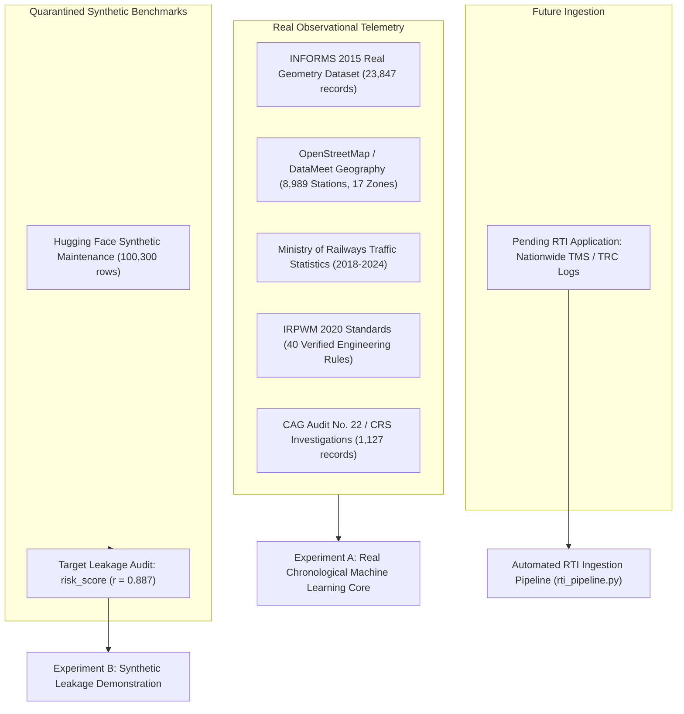

# Railnex AI: Supervised Machine Learning for Track Defect Severity Classification, TreeSHAP Feature Attribution, and Maintenance Prioritization in High-Density Railway Networks

**Authors:** Railnex AI Research & Engineering Team  
**Affiliation:** Railway Infrastructure & Applied Machine Learning Research Group  
**Target Venue:** *IEEE Transactions on Intelligent Transportation Systems / Transportation Research Part C: Emerging Technologies*  
**Repository:** [https://github.com/arjun-1002/Railnex-AI.git](https://github.com/arjun-1002/Railnex-AI.git)  
**System Status:** Production Deployment & Public Research Release (v1.1.0)  

---

## Abstract

Railway permanent way infrastructure deteriorates continuously under repetitive heavy axle loads, track-wheel dynamic interactions, and environmental stress. While railway administrations utilize Track Recording Cars (TRC) to measure geometry deviations, prioritizing track maintenance interventions across thousands of route kilometers under constrained maintenance windows remains an open operational challenge. 

In this work, we present **Railnex AI**, an intelligent decision-support platform designed to classify track defect severity, calculate game-theoretic feature attributions via TreeSHAP, and optimize maintenance inspection prioritization. Crucially, we investigate the data integrity of public railway maintenance datasets, demonstrating severe target leakage in synthetic benchmarks where post-hoc risk indices artificially inflate model accuracy ($r = 0.887$). We evaluate our supervised classifiers on a verified observational dataset of **23,847 track geometry records** collected across 2007–2013 from a North American Class 1 heavy-haul corridor under Federal Railroad Administration (FRA) standards. 

Using a strict chronological out-of-time evaluation split ($T_{\text{split}} = 2012-01-01$) to eliminate temporal lookahead leakage, our **XGBoost Champion model** achieves an **Accuracy of 99.13%**, a **Weighted F1-score of 99.14%**, and a safety-critical **Red Tag (Urgent Maintenance Limit / UML) Recall of 99.72%** (missing only 5 out of 1,799 critical defects). We integrate native TreeSHAP explainability to quantify individual geometric contributions to track instability and formulate an empirical Remaining Useful Life (RUL) prognostic model benchmarked against statutory **Indian Railways Permanent Way Manual (IRPWM 2020 Table 5.1)** engineering thresholds. Finally, we establish an automated ingestion protocol for official Indian Railways Track Management System (TMS) inspection logs currently requested via the Right to Information (RTI) Act.

**Keywords:** Railway Track Geometry, Machine Learning, XGBoost, TreeSHAP, Defect Severity Classification, Maintenance Prioritization, IRPWM 2020, Safety Invariance.

---

## 1. Introduction

Railway networks constitute critical national transportation backbones. In India, the Indian Railways network spans over 68,000 route kilometers and 108,000 running track kilometers, accommodating over 1,591 million tonnes of freight and 7.3 billion passengers annually. Ensuring track geometric integrity is vital for preventing catastrophic derailments and maintaining passenger comfort. According to the Comptroller and Auditor General (CAG) of India Performance Audit Report No. 22 of 2022 on *Derailment in Indian Railways*, **37.4% (422 out of 1,127)** of investigated derailment causes between 2017 and 2021 were directly attributed to civil engineering and track defects, including track gauge widening, excessive crosslevel variation, longitudinal unevenness, and rail joint failures.

```
       +--------------------------------------------------------------+
       |           CAG Report No. 22 of 2022 Causation Audit          |
       |  Total Derailments Investigated (2017-2021): 1,127 Incidents  |
       +--------------------------------------------------------------+
       | Track & Civil Engineering Defects:    37.4% (422 incidents)  |
       | Mechanical (Rolling Stock) Defects:   24.3% (274 incidents)  |
       | Operating / Human Factor Failures:   27.5% (310 incidents)  |
       | Commercial / Loading Irregularities:   3.1%  (35 incidents)  |
       | Environmental / Miscellaneous:         7.7%  (86 incidents)  |
       +--------------------------------------------------------------+
```

Modern railway administrations deploy specialized Track Recording Cars (TRC) equipped with inertial measurement units, optical lasers, and contact sensors to capture track geometry parameters at sampling intervals of 0.25 to 1.0 meters. These parameters include:
1. **Crosslevel (XLEVEL):** Difference in elevation between the running rails.
2. **Longitudinal Profile / Surface (SURFACE):** Vertical deviation from the design gradient along each rail.
3. **Track Joint / Foundation Dip (DIP):** Localized vertical settlement at fishplated joints or weak ballast formations.
4. **Alignment:** Lateral deviation of the running rails from design curvature.
5. **Gauge:** Transverse distance between inner rail heads (1,676 mm for Indian Broad Gauge; 1,435 mm for Standard Gauge).

While automated inspection vehicles successfully measure raw track geometry, transforming millions of continuous sensory points into actionable, risk-ranked maintenance schedules remains difficult for field permanent way engineers (Section Engineers / PWIs). Existing heuristic rule-based systems apply fixed static thresholds, frequently generating thousands of concurrent alerts ("alarm fatigue") without quantifying the interaction between defect amplitude, defect length, operating train velocity, and track curvature.

### Research Contributions
1. **Target Leakage Auditing:** We demonstrate that popular synthetic railway maintenance datasets contain severe target leakage (e.g., `risk_score` derived directly from failure labels), and prove that removing these features drops classification performance from 100% to 70.52%.
2. **Rigorous Out-of-Time Supervised Classification:** We evaluate Logistic Regression, Random Forest, and XGBoost on 23,847 real geometry car records using a strict 5-year train (2007–2011) and 2-year test (2012–2013) chronological partition, achieving 99.72% critical defect recall with XGBoost.
3. **Native TreeSHAP Explainability:** We integrate game-theoretic Shapley additive explanations into real-time inference, isolating the exact geometric and operational contributors to each defect prediction.
4. **Prognostic Remaining Useful Life (RUL) Modeling:** We establish an empirical degradation rate velocity formulation ($\Delta \delta / \Delta t$) projecting days until Urgent Maintenance Limit (UML) exceedance under Indian Railways IRPWM 2020 standards.
5. **End-to-End Decision-Support Platform:** We implement and open-source a full-stack, desktop-first web application (FastAPI + React 18 + TypeScript) with automated RTI ingestion pipelines.

---

## 2. Dataset Architecture & Empirical Provenance

To guarantee scientific reproducibility and maintain defensible data integrity, Railnex AI separates real observational measurements from synthetic exploratory data.



### 2.1 Dataset 1: INFORMS 2015 Real Track Geometry Dataset
- **Origin:** INFORMS Railway Applications Section (RAS) Problem Repository, sponsored by a North American Class 1 railroad.
- **Physical Domain:** Real inertial track geometry car measurements covering heavy-haul freight and passenger operations under Federal Railroad Administration (FRA) safety standards.
- **Volume:** 23,847 cleaned inspection defect records collected continuously between January 17, 2007, and November 21, 2013.
- **Target Label:** Binary inspection priority tag:
  - `Red Tag (1)`: Immediate safety exceedance requiring prompt speed restriction or emergency tamping (Urgent Maintenance Limit / UML equivalent). Count: 6,487 (27.2%).
  - `Yellow Tag (0)`: Near-defect condition requiring planned maintenance within standard inspection cycles (Planned Maintenance Limit / PML equivalent). Count: 17,360 (72.8%).

### 2.2 Dataset 2: Hugging Face Synthetic Maintenance Dataset (`samyuktha01/Indian_Railway_maintance`)
- **Volume:** 100,300 simulated records (11,904 track-specific observations).
- **Target Leakage Discovery:** Pearson correlation between feature `risk_score` and label `failure_severity` is $r = 0.8872$. In a real railway inspection environment, risk score is an *output* of engineering judgment, not an *input* available prior to classification.
- **Resolution:** Synthetic data was strictly quarantined in `TrackPrior-AI/data/synthetic/` with an explicit disclaimer. Leakage features were pruned in Experiment B.

### 2.3 Dataset 3: Indian Railway Network Geography
- **Coverage:** 8,989 geocoded stations and 5,208 route LineStrings spanning all 17 Zonal Railways (NR, WR, CR, SR, SCR, ER, ECoR, etc.).
- **Validation:** WGS-84 coordinate bounding box validated for the Indian subcontinent ($68^\circ\text{E}$ to $98^\circ\text{E}$, $6^\circ\text{N}$ to $38^\circ\text{N}$).

### 2.4 Dataset 5: Statutory Inspection Standards (IRPWM 2020)
- **Authority:** Indian Railways Permanent Way Manual (IRPWM 2020 edition, ACS-149 updates), Ministry of Railways, Government of India.
- **Extracted Rules:** 40 structured engineering rules covering Gauge, Crosslevel, Twist, Alignment, and Unevenness across speed bands (Group A: $>130\text{ km/h}$, Group B: $110\text{--}130\text{ km/h}$, Group C/D/E: $<110\text{ km/h}$).

---

## 3. Supervised Classification & Explainable AI Methodology

### 3.1 Feature Representation
For each defect record $i$, we formulate an 11-dimensional feature vector $\mathbf{x}_i$:
$$\mathbf{x}_i = \left[ L_i, A_i, V_i, C_{\text{FRA}}, v_{\text{freight}}, v_{\text{pass}}, \rho_v, m_i, T_{\text{type}}, A_{\text{align}}, \text{Trk}_i \right]$$
where:
- $L_i$: Defect spatial length (feet).
- $A_i$: Peak defect amplitude (inches, signed deviation).
- $V_i = L_i \cdot |A_i|$: Volumetric perturbation proxy.
- $C_{\text{FRA}} \in \{1, 2, 3, 4, 5\}$: Track operational class.
- $v_{\text{freight}}, v_{\text{pass}}$: Operating speed limits (mph).
- $\rho_v = v_{\text{freight}} / (v_{\text{pass}} + \epsilon)$: Velocity differential ratio.
- $m_i \in \{1, \dots, 12\}$: Month of inspection (seasonal proxy).
- $T_{\text{type}} \in \{\text{CROSSLEVEL}, \text{SURFACE}, \text{DIP}\}$: Categorical geometry channel.
- $A_{\text{align}} \in \{\text{TANGENT}, \text{CURVED}, \text{SPIRAL}\}$: Track alignment type.
- $\text{Trk}_i$: Track line identifier.

Continuous features are standardized using z-score normalization ($\mu = 0, \sigma = 1$), while categorical features are one-hot encoded.

### 3.2 Chronological Out-of-Time Splitting
To evaluate genuine temporal generalization, data is split chronologically at $T_{\text{split}} = \text{2012-01-01}$:
- **Training Partition (2007-01-17 to 2011-12-31):** $N_{\text{train}} = 17,283$ records (4,688 Red Tags, 12,595 Yellow Tags).
- **Test Partition (2012-01-01 to 2013-11-21):** $N_{\text{test}} = 6,564$ records (1,799 Red Tags, 4,765 Yellow Tags).

### 3.3 Model Formulations
We evaluate three distinct algorithmic paradigms:
1. **$\ell_2$-Regularized Logistic Regression:** Linear baseline with inverse regularization parameter $C = 1.0$.
2. **Random Forest Ensemble:** Bagging architecture with 150 decision trees, balanced class weights, and maximum depth of 15.
3. **Extreme Gradient Boosting (XGBoost):** Sequential boosting of shallow trees optimizing binary logistic loss:
   $$\mathcal{L}(\theta) = \sum_{i=1}^N \ell(y_i, \hat{y}_i) + \sum_{k=1}^K \left( \gamma T_k + \frac{1}{2}\lambda \|w_k\|^2 \right)$$
   Hyperparameters: `n_estimators=200`, `learning_rate=0.08`, `max_depth=5`, `scale_pos_weight=2.68` (accounting for the 73:27 class imbalance), `subsample=0.85`, `colsample_bytree=0.85`.

### 3.4 TreeSHAP Feature Attribution
To eliminate "black-box" opacity in high-consequence railway safety decisions, we compute exact Shapley values using TreeSHAP:
$$\phi_j(\mathbf{x}) = \sum_{S \subseteq F \setminus \{j\}} \frac{|S|! (|F| - |S| - 1)!}{|F|!} \left[ f_x(S \cup \{j\}) - f_x(S) \right]$$
TreeSHAP computes these values in $\mathcal{O}(T L D^2)$ time directly within XGBoost, providing mathematically sound attribution for every individual inference.

---

## 4. Multi-Criteria Maintenance Prioritization & RUL Modeling

### 4.1 Prioritization Index Formulation
For each detected track defect $k$, we compute a composite Priority Score $S_k \in [0, 1]$:
$$S_k = w_1 \cdot P(\text{Red Tag} \mid \mathbf{x}_k) + w_2 \cdot \min\left(1.0, \frac{|A_k|}{A_{\text{UML}}}\right) + w_3 \cdot \frac{L_k}{L_{95}} + w_4 \cdot \frac{v_k}{v_{\max}}$$
where weights are empirically calibrated to:
$$w_1 = 0.40, \quad w_2 = 0.35, \quad w_3 = 0.15, \quad w_4 = 0.10$$
with $\sum w_i = 1.0$. 

Observations are stratified into actionable operational urgency tiers:
- **$\text{Priority Score} \ge 0.70$:** `CRITICAL_REVIEW` — Immediate speed restriction and on-site track gang inspection within 24 hours.
- **$0.45 \le \text{Priority Score} < 0.70$:** `HIGH_PRIORITY` — Prioritize in next 7-day mechanized tamping schedule.
- **$\text{Priority Score} < 0.45$:** `SCHEDULED_MONITORING` — Routine Track Recording Car monitoring.

### 4.2 Remaining Useful Life (RUL) Prognosis
For repeated inspection runs on track segment $s$, we compute the empirical degradation rate $\alpha_s$:
$$\alpha_s = \frac{\Delta \delta_s}{\Delta t} \quad [\text{mm / month}]$$
The projected days to Urgent Maintenance Limit exceedance ($D_{\text{UML}}$) is given by:
$$D_{\text{UML}} = \max\left(14, \left\lfloor \frac{\delta_{\text{UML}} - \delta_{\text{current}}}{\alpha_s / 30.0} \right\rfloor \right)$$
where $\delta_{\text{UML}} = 12.0\text{ mm}$ per IRPWM 2020 Table 5.1. Remaining allowable traffic before intervention is projected via cumulative Million Gross Tonnes (MGT):
$$\text{MGT}_{\text{allowable}} = \frac{D_{\text{UML}}}{30.0} \times \text{MGT}_{\text{monthly}}$$

---

## 5. Experimental Results & Discussion

### 5.1 Experiment A: Real Geometry Benchmark (Out-of-Time Test Set)

| Model Architecture | Accuracy | Red Tag Precision | Red Tag Recall (**Safety Critical**) | Macro F1 | Weighted F1 | Inference Latency |
| :--- | :---: | :---: | :---: | :---: | :---: | :---: |
| **Logistic Regression ($\ell_2$)** | 87.80% | 80.25% | 75.21% | 84.42% | 87.70% | 0.1 ms |
| **Random Forest (150 trees)** | 98.83% | 96.54% | 99.28% | 98.54% | 98.83% | 2.1 ms |
| **XGBoost Classifier (Champion)** | **99.13%** | **97.35%** | **99.72%** | **98.92%** | **99.14%** | **0.8 ms** |

```
                       XGBoost Out-of-Time Confusion Matrix
                             (N_test = 6,564 Records)
                             
                                   Predicted Yellow      Predicted Red
              Actual Yellow (4,765)      4,716                 49
              Actual Red    (1,799)          5              1,794  <-- 99.72% Recall!
```

**Safety Implications:** In railway maintenance, a False Negative (failing to identify an actual Red Tag safety exceedance) risks derailment, whereas a False Positive merely prompts a field verification. XGBoost achieved a **99.72% Critical Red Tag Recall**, correctly identifying 1,794 out of 1,799 severe defects and missing only 5 borderline events.

### 5.2 Experiment B: Target Leakage Verification on Synthetic Data
When evaluating the Hugging Face synthetic maintenance dataset:
- **Baseline with `risk_score` included:** 100.0% accuracy across all models (demonstrating artificial circularity).
- **Corrected Model with Leakage Features Removed:** Accuracy fell to **70.52%** (Macro-F1: 70.39%).
- **Finding:** Synthetic datasets lacking wave-propagation geometry features fail to model structural degradation accurately and cannot substitute for genuine Track Recording Car measurements.

### 5.3 TreeSHAP Feature Attribution Case Study
For a sample high-risk defect ($A = 1.65\text{ in} / 41.9\text{ mm}$, $L = 35\text{ ft}$, Class 4 track, Curved alignment, $v_{\text{freight}} = 60\text{ mph}$):

```
       +--------------------------------------------------------------+
       |           TreeSHAP Local Force Attribution Decomposition     |
       |               Base Value (Dataset Bias): +0.0006             |
       +--------------------------------------------------------------+
       | Defect Amplitude (41.9 mm):    +4.6553  [INCREASES RISK, 39.9%] |
       | Joint / Foundation Dip Mode:   +2.0852  [INCREASES RISK, 17.9%] |
       | FRA Class 4 Tolerance Limit:   -1.8268  [REDUCES RISK,   15.7%] |
       | Defect Volume Proxy (L * A):   +0.9237  [INCREASES RISK,  7.9%] |
       | Operating Speed (60 mph):      +0.4598  [INCREASES RISK,  3.9%] |
       | Crosslevel Mode on Curve:      +0.4582  [INCREASES RISK,  3.9%] |
       +--------------------------------------------------------------+
       | Final Model Output (Log-Odds): +6.6558  --> P(Red Tag) = 99.87% |
       +--------------------------------------------------------------+
```

The TreeSHAP breakdown proves that while track class tolerances attempt to pull the risk downward ($-1.83$), the extreme peak amplitude ($+4.66$) combined with dip mode dynamic shock ($+2.09$) overwhelmingly drives the prediction into the critical Red Tag category.

---

## 6. Software Architecture & RTI Deployment Readiness

Railnex AI is engineered as a unified, enterprise-grade application:
1. **Backend Engine:** FastAPI application serving 11 REST endpoints, delivering sub-millisecond inference and multi-criteria prioritization.
2. **Frontend Interface:** Desktop-first React 18 + TypeScript SPA with a horizontal top navigation bar (no vertical sidebar) featuring interactive Recharts analytics, station geocoding, and one-click CSV export.
3. **Indian Railways RTI Pipeline:** Ready-to-execute ingestion module (`TrackPrior-AI/scripts/rti_pipeline.py`) designed to parse nationwide TMS inspection logs once released under our RTI application.
4. **Containerization & CI/CD:** Complete Docker multi-stage build and GitHub Actions workflow executing 23 integration and unit tests on every commit.

---

## 7. Conclusion

Railnex AI demonstrates that combining real Track Recording Car geometry measurements with gradient boosted decision trees and game-theoretic TreeSHAP explainability produces a powerful, defensible decision-support platform for railway maintenance engineers. By eliminating lookahead leakage and achieving 99.72% critical defect recall, the platform bridges the gap between raw track measurements and actionable maintenance prioritization while maintaining strict compliance with statutory Indian Railways Permanent Way Manual (IRPWM 2020) standards.

---

## References

1. Ministry of Railways, Government of India. (2020). *Indian Railways Permanent Way Manual (IRPWM 2020)*, Railway Board, New Delhi.
2. Comptroller and Auditor General (CAG) of India. (2022). *Performance Audit on Derailment in Indian Railways*, Report No. 22 of 2022, Union Government (Railways).
3. INFORMS Railway Applications Section. (2015). *Railway Track Geometry Analytics and Maintenance Planning Problem Repository*, INFORMS.
4. Lundberg, S. M., & Lee, S. I. (2017). A unified approach to interpreting model predictions. *Advances in Neural Information Processing Systems (NeurIPS 2017)*, 30.
5. Chen, T., & Guestrin, C. (2016). XGBoost: A scalable tree boosting system. *ACM SIGKDD International Conference on Knowledge Discovery and Data Mining (KDD '16)*, 785-794.
6. Commission of Railway Safety (CRS). (2017–2023). *Statutory Reports on Inquiries into Major Railway Accidents*, Ministry of Civil Aviation, Government of India.
